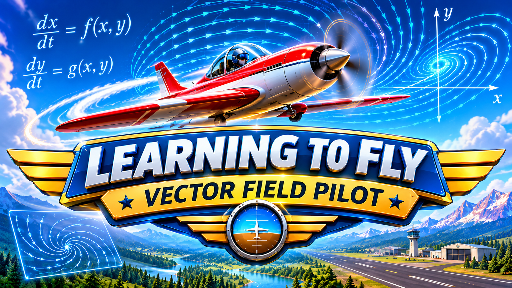
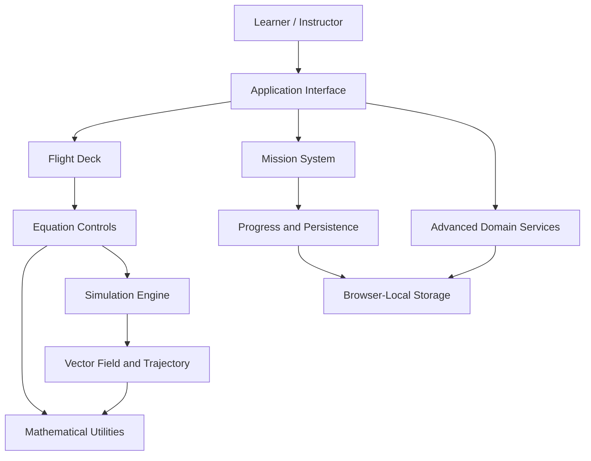
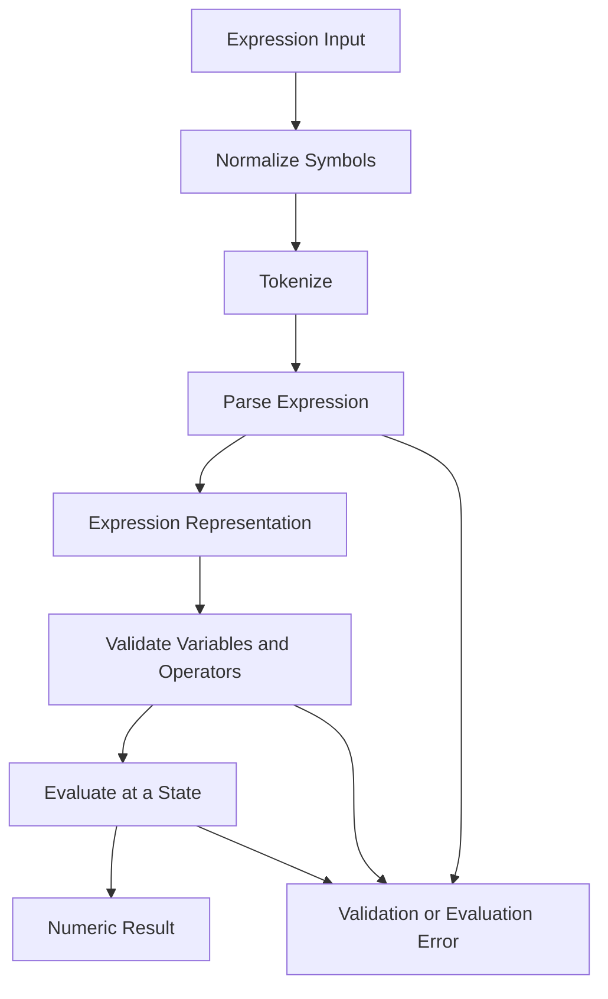
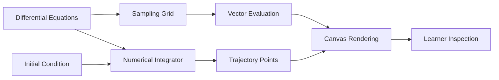
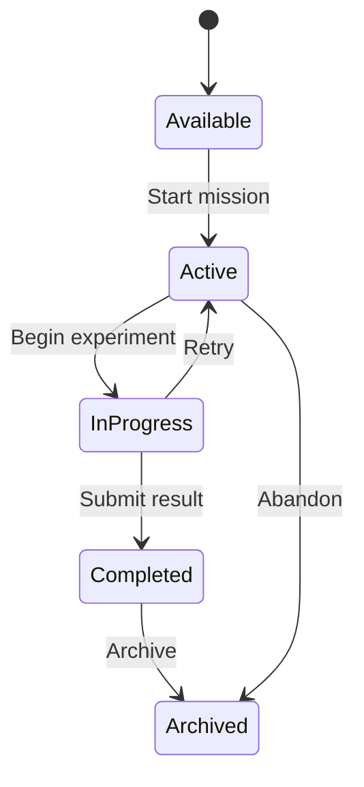
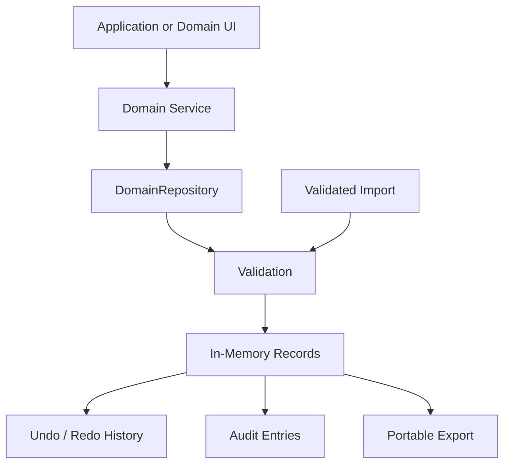
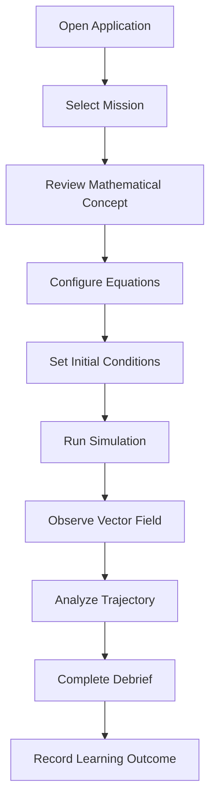

# Learning to Fly: The Vector Field Pilot

## An Interactive Differential Equations, Vector Fields, and Flight Simulation Learning Platform





**Learning to Fly: The Vector Field Pilot** is an interactive educational web application designed to help learners explore differential equations, vector fields, trajectories, equilibrium points, numerical integration, and the relationship between mathematical models and dynamic systems.

The project presents mathematical concepts through an aviation-inspired learning environment. Instead of treating differential equations as purely symbolic exercises, learners interact with a simulated flight deck, configure equations, observe trajectories, complete missions, and investigate how changing model parameters affects system behavior.

The application combines:

- An interactive browser-based learning interface.
- A vector-field and trajectory simulation environment.
- Mathematical expression parsing and numerical solving.
- Mission-based educational activities.
- Learner progress and persistence.
- Reusable domain services for lessons, experiments, assessments, and educational resources.
- Supporting systems for accessibility, data management, search, and application workflows.

This repository represents the completed educational prototype and its accompanying reusable subsystem foundations.

---

# Table of Contents

1. [Project Overview](#1-project-overview)
2. [Project Goals](#2-project-goals)
3. [Core Learning Experience](#3-core-learning-experience)
4. [System Architecture](#4-system-architecture)
5. [Application Structure](#5-application-structure)
6. [Mathematical Foundations](#6-mathematical-foundations)
7. [Expression Processing](#7-expression-processing)
8. [Numerical Simulation](#8-numerical-simulation)
9. [Vector Fields and Trajectories](#9-vector-fields-and-trajectories)
10. [Mission and Lesson Systems](#10-mission-and-lesson-systems)
11. [Progress and Persistence](#11-progress-and-persistence)
12. [Advanced Domain Modules](#12-advanced-domain-modules)
13. [Data Import and Export](#13-data-import-and-export)
14. [User Interface and Accessibility](#14-user-interface-and-accessibility)
15. [Application Workflows](#15-application-workflows)
16. [Installation and Local Development](#16-installation-and-local-development)
17. [Testing and Quality Assurance](#17-testing-and-quality-assurance)
18. [Security, Privacy, and Limitations](#18-security-privacy-and-limitations)
19. [Extension and Customization](#19-extension-and-customization)
20. [Deployment and Future Development](#20-deployment-and-future-development)

---

# 1. Project Overview

## 1.1 What Is Vector Field Pilot?

Vector Field Pilot is a browser-based educational environment for understanding how mathematical systems evolve over time.

Its central educational idea is that a differential equation is not merely a formula. It describes how a system changes.

For example, consider a two-dimensional autonomous system:

\[
\frac{dx}{dt}=f(x,y)
\]

\[
\frac{dy}{dt}=g(x,y)
\]

The pair of equations defines a vector at every point in the plane.

The application helps learners investigate:

- The direction of motion.
- The speed of motion.
- The shape of solution trajectories.
- Equilibrium points.
- Changes in system behavior.
- The influence of initial conditions.
- The influence of parameters.

The aviation metaphor provides a consistent learning framework:

| Aviation concept | Mathematical concept |
|---|---|
| Flight controls | Equation parameters |
| Aircraft position | State variables |
| Flight path | Solution trajectory |
| Wind field | Vector field |
| Flight stability | Equilibrium stability |
| Flight mission | Learning activity |
| Flight debrief | Mathematical analysis |
| Flight recorder | Simulation record |

## 1.2 Project Characteristics

The application is designed as a client-side educational prototype.

Its principal characteristics include:

- Browser-based execution.
- Modular JavaScript organization.
- Interactive mathematical visualization.
- Reusable application services.
- Local-first data management.
- Educational mission workflows.
- Testable mathematical utilities.
- Extensible subsystem boundaries.

## 1.3 Intended Audience

The application is intended for:

- Students learning differential equations.
- Teachers introducing dynamical systems.
- Independent mathematics learners.
- STEM education programs.
- Developers experimenting with mathematical visualization.
- Educational technology researchers.

## 1.4 What the Application Is Not

Vector Field Pilot is an educational simulator.

It is not:

- Certified aircraft-control software.
- A real-world flight simulator.
- A replacement for professional engineering tools.
- A safety-critical numerical analysis platform.
- A validated aviation training system.

All simulated aircraft and flight behaviors are educational abstractions.

---

# 2. Project Goals

## 2.1 Educational Goals

The primary goal is to make mathematical behavior visible.

Traditional mathematical instruction often separates equations, graphs, and physical interpretations.

Vector Field Pilot attempts to connect these representations.

A learner can change an equation and investigate how the resulting vector field changes.

The intended learning cycle is:

1. Form a hypothesis.
2. Configure a mathematical model.
3. Select an initial condition.
4. Run a simulation.
5. Observe the resulting trajectory.
6. Compare the result with the hypothesis.
7. Explain the mathematical behavior.

## 2.2 Technical Goals

The technical goals include:

- Separation of mathematical logic from presentation.
- Reusable domain services.
- Consistent data validation.
- Predictable application state.
- Browser-compatible modules.
- Lightweight installation.
- Extensible simulation functionality.
- Automated mathematical testing.

## 2.3 Design Principles

### Principle 1: Mathematics before decoration

The visualization must communicate the underlying mathematical system rather than obscure it.

### Principle 2: Experimentation should be reversible

Learners should be able to modify parameters, compare results, and return to previous configurations.

### Principle 3: Data should be portable

Where supported, application data should be exportable and importable.

### Principle 4: Modules should remain reusable

Educational workflows should not require all application services to be tightly coupled.

### Principle 5: Safety boundaries must be explicit

The application should never imply that an educational simulation is suitable for real aircraft operations.

---

# 3. Core Learning Experience

## 3.1 The Flight Deck

The flight deck is the primary interaction environment.

It provides the conceptual setting in which a learner configures and observes a mathematical system.

The main workflow includes:

- Choosing a learning activity.
- Entering or adjusting equations.
- Selecting initial conditions.
- Configuring simulation parameters.
- Running the simulation.
- Inspecting the resulting behavior.
- Reviewing the outcome.

## 3.2 Equation Controls

The equation controls provide the learner with a way to explore mathematical models.

A general two-dimensional system can be written as:

\[
\dot{x}=f(x,y)
\]

\[
\dot{y}=g(x,y)
\]

The learner can investigate different choices of \(f\) and \(g\).

For example:

\[
\dot{x}=y
\]

\[
\dot{y}=-x
\]

This system produces circular trajectories around the origin for nonzero initial conditions.

Another example is:

\[
\dot{x}=x
\]

\[
\dot{y}=-y
\]

This produces expansion in one direction and contraction in the other.

## 3.3 Mission-Based Learning

Missions organize the learning experience into achievable activities.

A mission can define:

- A mathematical topic.
- A challenge.
- A difficulty level.
- A target outcome.
- A completion state.
- A learner progress record.

A typical mission asks the learner to predict the behavior of a system before running the simulation.

## 3.4 Debriefing

A debrief is the opportunity to interpret the result.

The educational emphasis is on explaining why the simulation behaves as it does.

Useful debrief questions include:

- Where are the equilibrium points?
- Does the trajectory approach or leave an equilibrium?
- Does the system appear periodic?
- What happens if the initial condition changes?
- What happens if a parameter changes?
- Does the observed behavior match the mathematical prediction?

---

# 4. System Architecture

## 4.1 Architectural Overview

The application uses a modular client-side architecture.

The architecture separates the user interface, mathematical functionality, simulation behavior, learning workflows, and reusable domain services.



The diagram describes the intended logical relationships. It does not imply that every optional domain service is connected to the primary user interface.

## 4.2 Architectural Layers

### Presentation layer

Responsible for:

- Layout.
- Navigation.
- Controls.
- Visual feedback.
- User interaction.
- Educational presentation.

### Application layer

Responsible for:

- Mission workflows.
- Simulation coordination.
- User actions.
- Progress updates.
- Application-level state.

### Mathematical layer

Responsible for:

- Expression handling.
- Numerical calculations.
- Differential-equation utilities.
- Vector operations.
- Equilibrium analysis foundations.

### Domain services

Responsible for reusable educational and administrative workflows.

Examples include:

- Lesson authoring.
- Assessment management.
- Experiment notebooks.
- Resource management.
- Classroom rosters.
- Study planning.

### Persistence layer

Responsible for local data storage and portable data representations where implemented.

## 4.3 Design Boundaries

The project distinguishes between:

**Integrated application functionality**

Features that form part of the primary learning experience.

**Reusable subsystem foundations**

Modules that provide reusable services but may require additional interface integration before becoming complete user-facing workflows.

This distinction is important when extending the application.

---

# 5. Application Structure

A simplified view of the repository is:

```text
vector-field-pilot/
│
├── index.html
├── styles.css
├── README.md
├── package.json
│
├── src/
│   ├── advanced/
│   │   ├── DomainRepository.js
│   │   ├── MissionPlanner.js
│   │   ├── LessonAuthoring.js
│   │   ├── ExperimentNotebook.js
│   │   ├── AssessmentBuilder.js
│   │   ├── RubricEngine.js
│   │   ├── ClassroomRoster.js
│   │   ├── TeamWorkspace.js
│   │   ├── ResourceLibrary.js
│   │   ├── BookmarkManager.js
│   │   ├── ResearchQuestionBank.js
│   │   ├── DataSetCatalog.js
│   │   ├── ChartPresetManager.js
│   │   ├── NotificationCenter.js
│   │   ├── ReleaseChecklist.js
│   │   ├── AccessibilityAudit.js
│   │   ├── FeedbackInbox.js
│   │   ├── SupportKnowledgeBase.js
│   │   ├── FormulaLibrary.js
│   │   ├── ParameterSweep.js
│   │   ├── SensitivityStudy.js
│   │   ├── ScenarioCompare.js
│   │   ├── CalibrationProfiles.js
│   │   ├── ExportQueue.js
│   │   ├── ImportQueue.js
│   │   ├── VersionHistory.js
│   │   ├── PrivacySettings.js
│   │   ├── ConsentLedger.js
│   │   ├── AuditTrailViewer.js
│   │   ├── OfflineSyncManager.js
│   │   ├── StudyPlanner.js
│   │   ├── CertificateManager.js
│   │   ├── SimulationPresets.js
│   │   ├── CsvToolkit.js
│   │   ├── JsonSchemaTools.js
│   │   ├── KeyboardShortcuts.js
│   │   ├── FocusSession.js
│   │   ├── SearchIndex.js
│   │   └── EventBus.js
│   │
│   └── [core application modules]
│
├── docs/
│   └── continuation/
│       └── ADVANCED_MODULES.md
│
└── tests/
    ├── math.test.js
    └── expanded.test.js
```

The core application modules are organized separately from the continuation's advanced services.

Consult the actual source tree for the definitive file inventory.

## 5.1 Why Use a Shared Domain Repository?

The advanced services share common data-management behavior.

Instead of implementing record creation, validation, searching, history, and export independently, each service delegates those responsibilities to `DomainRepository`.

This reduces duplication and improves consistency.

---

# 6. Mathematical Foundations

## 6.1 Ordinary Differential Equations

An ordinary differential equation describes a relationship between a function and one or more of its derivatives.

A first-order equation has the form:

\[
\frac{dy}{dt}=f(t,y)
\]

A learner can interpret the derivative as the instantaneous rate of change.

For a two-dimensional autonomous system:

\[
\frac{dx}{dt}=f(x,y)
\]

\[
\frac{dy}{dt}=g(x,y)
\]

the system defines a vector field over the state plane.

## 6.2 State Vectors

The state of the system is represented by:

\[
\mathbf{x}(t)=
\begin{bmatrix}
x(t)\\
y(t)
\end{bmatrix}
\]

The system becomes:

\[
\frac{d\mathbf{x}}{dt}
=
\begin{bmatrix}
f(x,y)\\
g(x,y)
\end{bmatrix}
\]

This representation is useful because it treats the two equations as one vector-valued function.

## 6.3 Vector Fields

A vector field assigns a vector to each point in a region.

\[
\mathbf{F}(x,y)=
\begin{bmatrix}
f(x,y)\\
g(x,y)
\end{bmatrix}
\]

The direction of the vector indicates the direction of local motion.

Its magnitude represents the instantaneous speed in state space.

## 6.4 Equilibrium Points

An equilibrium occurs when:

\[
f(x^*,y^*)=0
\]

and

\[
g(x^*,y^*)=0
\]

At an equilibrium, the system has no instantaneous motion.

Equilibrium analysis is a major conceptual bridge between differential equations and system stability.

## 6.5 Linearization

Near an equilibrium, a nonlinear system can be approximated using its Jacobian matrix:

\[
J(x,y)=
\begin{bmatrix}
\frac{\partial f}{\partial x} &
\frac{\partial f}{\partial y}\\
\frac{\partial g}{\partial x} &
\frac{\partial g}{\partial y}
\end{bmatrix}
\]

Evaluating the Jacobian at an equilibrium gives a local linear approximation.

Eigenvalues of this matrix provide information about local behavior.

This is a mathematical foundation for the project's equilibrium-analysis and sensitivity-related educational capabilities.

## 6.6 Suggested Learning Progression

1. Understand rates of change.
2. Interpret a single differential equation.
3. Introduce a two-dimensional state.
4. Explore vector fields.
5. Trace solution curves.
6. Identify equilibrium points.
7. Study local stability.
8. Compare nonlinear systems.
9. Investigate parameter changes.
10. Explain observed behavior.

---

# 7. Expression Processing

## 7.1 Purpose

The expression-processing layer allows mathematical expressions to be represented and evaluated by application code.

The design objective is to avoid treating learner-entered expressions as arbitrary executable JavaScript.

Expressions should be parsed and evaluated through a controlled mathematical representation.

## 7.2 Conceptual Processing Pipeline



## 7.3 Supported Mathematical Concepts

The mathematical expression system is intended for operations such as:

- Addition.
- Subtraction.
- Multiplication.
- Division.
- Powers.
- Parentheses.
- Variables.
- Mathematical functions supported by the parser.

The exact supported syntax should be determined from the implementation and its tests.

## 7.4 Error Handling

An expression engine should distinguish:

- Invalid characters.
- Unexpected tokens.
- Missing parentheses.
- Unknown variables.
- Unsupported functions.
- Division by zero.
- Non-finite numerical results.

A useful error message should identify the problem without exposing internal implementation details.

## 7.5 Security Considerations

Never replace a mathematical parser with unrestricted `eval()` for learner input.

A production implementation should:

- Whitelist mathematical operations.
- Validate variable names.
- Limit expression length.
- Limit nesting depth.
- Detect non-finite results.
- Avoid executing arbitrary code.

---

# 8. Numerical Simulation

## 8.1 Why Numerical Methods Are Necessary

Many differential equations cannot be solved conveniently using elementary closed-form expressions.

Numerical methods approximate the system's behavior by advancing the state in small time increments.

For a system:

\[
\frac{d\mathbf{x}}{dt}=F(\mathbf{x},t)
\]

a numerical solver approximates:

\[
\mathbf{x}_{n+1}
\approx
\mathbf{x}(t_n+h)
\]

where \(h\) is the integration step size.

## 8.2 Euler's Method

Euler's method is:

\[
\mathbf{x}_{n+1}
=
\mathbf{x}_n+hF(\mathbf{x}_n,t_n)
\]

It is easy to explain and useful for introductory visualization.

However, its accuracy can deteriorate when the step size is too large.

## 8.3 Runge-Kutta Methods

A common higher-accuracy approach is the fourth-order Runge-Kutta method.

For:

\[
\frac{dy}{dt}=f(t,y)
\]

define:

\[
k_1=f(t_n,y_n)
\]

\[
k_2=f(t_n+h/2,y_n+hk_1/2)
\]

\[
k_3=f(t_n+h/2,y_n+hk_2/2)
\]

\[
k_4=f(t_n+h,y_n+hk_3)
\]

Then:

\[
y_{n+1}
=
y_n+\frac{h}{6}(k_1+2k_2+2k_3+k_4)
\]

The numerical method used by a particular simulation path must be verified against its implementation.

## 8.4 Step Size

The step size influences numerical accuracy and computational cost.

A smaller step size generally means:

- More evaluation steps.
- Higher computational cost.
- Potentially improved resolution.

A larger step size generally means:

- Fewer evaluation steps.
- Lower computational cost.
- Potentially larger numerical error.

The educational interface should make this tradeoff understandable.

## 8.5 Numerical Failure Conditions

A simulation should detect:

- Non-finite state values.
- Diverging trajectories.
- Invalid function evaluations.
- Excessive integration steps.
- Invalid step sizes.
- Unexpected termination.

A simulation should stop safely when its state becomes invalid.

---

# 9. Vector Fields and Trajectories

## 9.1 Vector Field Construction

For each sample point:

\[
(x_i,y_j)
\]

evaluate:

\[
u_{ij}=f(x_i,y_j)
\]

\[
v_{ij}=g(x_i,y_j)
\]

The resulting vector is:

\[
\mathbf{F}_{ij}=(u_{ij},v_{ij})
\]

This collection of vectors provides a visual representation of the system.

## 9.2 Trajectory Construction

A trajectory is obtained by integrating from an initial condition:

\[
\mathbf{x}(0)=\mathbf{x}_0
\]

The solver produces a sequence:

\[
\mathbf{x}_0,\mathbf{x}_1,\mathbf{x}_2,\ldots,\mathbf{x}_n
\]

Connecting these states produces an approximate solution curve.

## 9.3 Initial Conditions

Different initial conditions can produce different trajectories even when the governing equations remain unchanged.

For example:

\[
\dot{x}=y,\qquad \dot{y}=-x
\]

has circular solution curves whose radii depend on the initial condition.

## 9.4 Simulation Visualization Pipeline



## 9.5 Visualization Design Considerations

A useful vector-field visualization should:

- Maintain consistent coordinate scaling.
- Distinguish direction from magnitude.
- Avoid excessive visual clutter.
- Show trajectory direction.
- Identify equilibrium locations where possible.
- Communicate the initial condition.
- Provide clear axis labels.

---

# 10. Mission and Lesson Systems

## 10.1 Mission-Based Instruction

The mission system provides a structured learning workflow.

A mission can be modeled as:

```json
{
  "title": "Investigate a Stable Equilibrium",
  "topic": "equilibrium",
  "difficulty": 2,
  "status": "active",
  "description": "Explore how nearby trajectories behave."
}
```

This is an illustrative record, not a claim that this exact mission is preloaded.

## 10.2 Mission Lifecycle



## 10.3 Lesson Authoring

The lesson-authoring subsystem provides a reusable data service for managing lesson records.

Potential lesson content includes:

- Topic.
- Explanation.
- Difficulty level.
- Estimated duration.
- Publication status.
- Tags.

## 10.4 Assessments

The assessment subsystem supports reusable assessment records.

An assessment may contain:

- A prompt.
- An expected answer.
- A topic.
- A point value.
- A difficulty level.
- An explanation.

## 10.5 Rubrics

The rubric subsystem provides structured criteria and weighted scoring information.

A production grading workflow would still require a user interface, instructor permissions, and carefully tested scoring rules.

---

# 11. Progress and Persistence

## 11.1 Learning Progress

Progress tracking supports continuity across learning activities.

Examples of useful progress information include:

- Completed missions.
- Active missions.
- Experiment history.
- Assessment results.
- Recently visited topics.

## 11.2 Local-First Architecture

The application includes local-first data-management foundations.

This approach is useful for educational prototypes because it reduces dependence on remote infrastructure.

However, local persistence is not equivalent to a secure cloud account system.

## 11.3 Repository Data Flow



## 11.4 Undo and Redo

The shared repository includes history-management foundations.

The intended interaction is:

- Save a previous record state.
- Apply a change.
- Restore the prior state when undo is requested.
- Reapply a previously undone state when redo is requested.

Applications should test history behavior carefully when records are imported or removed.

## 11.5 Persistence Limitations

The shared repository is an in-memory domain service.

A production application must explicitly connect services to durable storage if records are expected to survive page reloads.

Potential persistence options include:

- IndexedDB.
- A server-side database.
- A synchronized application API.
- Encrypted local storage for carefully selected use cases.

Do not assume that every domain service automatically persists its data to the browser.

---

# 12. Advanced Domain Modules

The continuation introduces reusable services under `src/advanced/`.

## 12.1 Shared Domain Repository

`DomainRepository.js` provides shared operations:

- Record creation.
- Record updates.
- Record removal.
- Record lookup.
- Filtering.
- Sorting.
- Summaries.
- Undo and redo.
- Export and import.
- Audit entries.
- Revision tracking.

Its purpose is to make domain services consistent.

## 12.2 Educational Services

| Module | Responsibility |
|---|---|
| MissionPlanner | Mission record management |
| LessonAuthoring | Lesson record management |
| ExperimentNotebook | Mathematical experiment records |
| AssessmentBuilder | Assessment records |
| RubricEngine | Scoring criteria |
| StudyPlanner | Study schedule records |
| CertificateManager | Certificate records |

## 12.3 Collaboration and Classroom Services

| Module | Responsibility |
|---|---|
| ClassroomRoster | Learner records |
| TeamWorkspace | Team records |
| FeedbackInbox | Feedback records |
| NotificationCenter | Notification records |

These are data-service foundations. They do not, by themselves, provide authenticated multi-user collaboration.

## 12.4 Research and Data Services

| Module | Responsibility |
|---|---|
| ResearchQuestionBank | Research questions |
| DataSetCatalog | Dataset metadata |
| ChartPresetManager | Chart configuration records |
| FormulaLibrary | Reusable mathematical formulas |
| ParameterSweep | Parameter sweep definitions |
| SensitivityStudy | Sensitivity study records |
| ScenarioCompare | Scenario comparison records |
| CalibrationProfiles | Calibration settings |

## 12.5 Administration and Governance Services

| Module | Responsibility |
|---|---|
| ReleaseChecklist | Release tasks |
| AccessibilityAudit | Accessibility findings |
| SupportKnowledgeBase | Support article records |
| VersionHistory | Version records |
| PrivacySettings | Privacy rule records |
| ConsentLedger | Consent records |
| AuditTrailViewer | Audit view records |
| OfflineSyncManager | Synchronization queue records |

The presence of privacy or consent record services does not establish legal compliance or provide a complete privacy-management program.

## 12.6 Import and Export Services

| Module | Responsibility |
|---|---|
| CsvToolkit | CSV parsing and serialization |
| JsonSchemaTools | JSON shape validation |
| ImportQueue | Import job records |
| ExportQueue | Export job records |

## 12.7 Interaction Utilities

| Module | Responsibility |
|---|---|
| KeyboardShortcuts | Shortcut registration |
| FocusSession | Focus timer state machine |
| SearchIndex | In-memory search index |
| EventBus | Event subscription and delivery |

## 12.8 Example: Using a Domain Service

```javascript
import { MissionPlanner } from "./src/advanced/MissionPlanner.js";

const planner = new MissionPlanner();

planner.addEventListener("change", (event) => {
  console.log("Mission repository changed:", event.detail);
});

const result = planner.create({
  title: "Explore Vector Fields",
  description: "Investigate the direction of a two-dimensional system.",
  difficulty: 2,
  status: "active",
  topic: "vector-fields",
  tags: ["differential-equations", "visualization"]
});

if (!result.ok) {
  console.error(result.errors);
} else {
  console.log("Created mission:", result.record);
}
```

The precise method signatures should always be checked against the source module.

---

# 13. Data Import and Export

## 13.1 CSV Support

The CSV toolkit provides:

- Parsing.
- Quoted field support.
- Escaped quotation handling.
- Serialization.
- Column inference.
- Required-field validation.
- Browser download support.

Example:

```javascript
import { parseCsv, stringifyCsv } from "./src/advanced/CsvToolkit.js";

const source = [
  "name,topic,difficulty",
  '"Vector Fields","Differential Equations",2',
  '"Equilibrium Analysis","Dynamical Systems",3'
].join("\n");

const rows = parseCsv(source);

console.log(rows);

const exported = stringifyCsv(rows);
console.log(exported);
```

## 13.2 JSON Validation

The JSON tools provide lightweight shape validation.

Example schema:

```javascript
const missionSchema = {
  type: "object",
  required: ["title", "difficulty"],
  properties: {
    title: {
      type: "string",
      maxLength: 120
    },
    difficulty: {
      type: "number",
      minimum: 1,
      maximum: 5
    }
  }
};
```

Example validation:

```javascript
import { validateShape } from "./src/advanced/JsonSchemaTools.js";

const mission = {
  title: "Explore Equilibrium",
  difficulty: 2
};

const errors = validateShape(mission, missionSchema);

if (errors.length === 0) {
  console.log("Mission data is valid.");
}
```

## 13.3 Data Portability

Portable data formats make it easier to:

- Back up educational records.
- Transfer records between environments.
- Inspect project data.
- Build migration workflows.
- Integrate future server-side services.

Imported data should always be validated before being trusted.

---

# 14. User Interface and Accessibility

## 14.1 Interface Design Goals

The interface should communicate the relationship between equations, numerical behavior, and visual output.

The main interface should make the following information easy to locate:

- Current mission.
- Current equations.
- Initial conditions.
- Simulation controls.
- Vector-field visualization.
- Trajectory information.
- Learning progress.

## 14.2 Responsive Design

A browser-based educational application should support:

- Desktop displays.
- Laptop displays.
- Tablet displays.
- Narrow browser windows.

The visualization should remain usable when the available display area changes.

## 14.3 Accessibility Requirements

Recommended accessibility practices include:

- Semantic HTML.
- Keyboard-accessible controls.
- Visible focus indicators.
- Descriptive button labels.
- Sufficient color contrast.
- Text alternatives for important visual information.
- Avoiding color as the only method of communicating meaning.
- Respecting reduced-motion preferences.

## 14.4 Keyboard Shortcuts

The shortcut registry provides reusable shortcut management.

Example:

```javascript
import { KeyboardShortcuts } from "./src/advanced/KeyboardShortcuts.js";

const shortcuts = new KeyboardShortcuts(document);

shortcuts.register(
  "start-simulation",
  "ctrl+enter",
  () => {
    console.log("Start simulation requested");
  },
  "Start the current simulation"
);
```

The example demonstrates registration. The actual simulation action must be connected by the consuming interface.

## 14.5 Focus Sessions

The focus-session service provides a timer state machine for structured study sessions.

It supports:

- Start.
- Pause.
- Resume.
- Completion.
- Switching between focus and break modes.
- Session summaries.

A visual timer component can subscribe to its events.

---

# 15. Application Workflows

## 15.1 Learner Workflow



## 15.2 Instructor Workflow

A future instructor-facing workflow can use the reusable services to:

1. Create lessons.
2. Organize missions.
3. Prepare assessment records.
4. Define rubric criteria.
5. Review learner feedback.
6. Organize educational resources.
7. Export records for review.

These workflows require suitable interface integration and access-control design.

## 15.3 Research Workflow

A research-oriented workflow can use:

- Experiment notebooks.
- Formula records.
- Dataset metadata.
- Parameter sweep definitions.
- Sensitivity study definitions.
- Scenario comparison records.

This creates a foundation for structured mathematical exploration.

---

# 16. Installation and Local Development

## 16.1 Requirements

The project is designed to run in a modern browser.

Recommended development tools:

- A current version of Chrome, Firefox, Safari, or Edge.
- Python 3 for a simple static development server.
- A code editor such as Visual Studio Code.
- Node.js for running the included JavaScript tests.

The precise package scripts and dependencies should be checked in `package.json`.

## 16.2 Download and Extract

Download the project archive and extract it.

The project root contains:

```text
index.html
styles.css
package.json
src/
tests/
docs/
README.md
```

## 16.3 Start a Local Server

From the project root:

```bash
python -m http.server 8000
```

Open:

```text
http://localhost:8000
```

A local HTTP server is recommended instead of opening `index.html` directly because browser module loading and other web features may be restricted under the `file://` protocol.

## 16.4 Install Development Dependencies

If the project includes a `package.json` with dependencies, install them using:

```bash
npm install
```

If no external dependencies are required for a particular test, Node.js may execute that test directly.

## 16.5 Run the Application

Start the local server and open the local URL in a browser.

For development:

1. Edit a source file.
2. Refresh the browser.
3. Inspect the browser console.
4. Run relevant tests.
5. Verify the affected learning workflow.

## 16.6 Troubleshooting

### Page does not load

Check:

- The server is running.
- The correct project directory is being served.
- The URL uses the correct port.
- The browser console does not report missing modules.

### JavaScript module errors

Check:

- Import paths.
- File names and letter casing.
- Relative paths.
- Browser support.
- Server configuration.

### Simulation produces unexpected values

Check:

- The equation syntax.
- Initial conditions.
- Step size.
- Integration duration.
- Numerical error conditions.
- Whether the selected model is well-defined over the chosen state region.

---

# 17. Testing and Quality Assurance

## 17.1 Test Strategy

The project includes mathematical and expanded subsystem test files.

The previously executed validation included:

```bash
node tests/math.test.js
node tests/expanded.test.js
```

The reported results were:

```text
All mathematical tests passed.
All expanded subsystem tests passed.
```

The JavaScript source files were also checked using Node's syntax checker.

These results describe the validation performed on the delivered project version; they should not be interpreted as a guarantee of complete browser, accessibility, performance, or production security testing.

## 17.2 Mathematical Tests

Mathematical tests should cover:

- Expression parsing.
- Numerical evaluation.
- Differential-equation behavior.
- Expected trajectory properties.
- Invalid input.
- Non-finite output.
- Boundary conditions.

## 17.3 Domain-Service Tests

Domain services should be tested for:

- Successful record creation.
- Required-field validation.
- Invalid numerical values.
- Duplicate identifiers.
- Record updates.
- Record deletion.
- Search and filtering.
- Undo and redo.
- Import validation.
- Export structure.

## 17.4 Example Test

```javascript
import { MissionPlanner } from "../src/advanced/MissionPlanner.js";

const planner = new MissionPlanner();

const created = planner.create({
  title: "Vector Field Investigation",
  difficulty: 2,
  status: "active",
  topic: "vector-fields"
});

if (!created.ok) {
  throw new Error(created.errors.join("; "));
}

const saved = planner.get(created.record.id);

if (!saved || saved.title !== "Vector Field Investigation") {
  throw new Error("Mission retrieval failed.");
}

console.log("Mission service test passed.");
```

## 17.5 Recommended Additional Testing

Before a production release, add:

- Browser-based integration tests.
- End-to-end user workflow tests.
- Accessibility audits.
- Performance benchmarks.
- Large-data import tests.
- Cross-browser visual tests.
- Security reviews.
- Backup and restore tests.

---

# 18. Security, Privacy, and Limitations

## 18.1 Local-First Does Not Mean Secure by Default

The local-first design can reduce unnecessary data transmission.

However, locally stored information can still be exposed through:

- Shared devices.
- Browser profiles.
- Malicious extensions.
- Cross-site scripting.
- Insecure application dependencies.
- Unprotected backups.

Sensitive educational records should not be collected without an appropriate privacy and security design.

## 18.2 Input Validation

Validate all user-controlled data.

Examples include:

- Mathematical expressions.
- Imported JSON.
- CSV files.
- URLs.
- Numerical parameters.
- Text fields.

## 18.3 Imported Data

Treat imported content as untrusted.

Do not execute imported strings as JavaScript.

Validate file size, structure, field types, and acceptable values.

## 18.4 Authentication

The reusable classroom and team services are not a substitute for an authentication system.

A production deployment with multiple users needs:

- Authentication.
- Authorization.
- Account lifecycle management.
- Secure session handling.
- Server-side validation.
- Access-control testing.

## 18.5 Cloud Synchronization

The offline synchronization module provides a reusable record-management foundation.

It does not establish a complete distributed synchronization protocol.

A production synchronization system must handle:

- Concurrent edits.
- Conflict resolution.
- Retry policies.
- Idempotency.
- Authentication.
- Data integrity.
- Network failures.

## 18.6 Educational Safety

All flight-related metaphors and simulations are educational.

No output should be used to operate an aircraft or determine real-world flight safety.

---

# 19. Extension and Customization

## 19.1 Add a New Domain Service

A new service can reuse `DomainRepository`.

A typical implementation should:

1. Define a record schema.
2. Define required fields.
3. Implement validation.
4. Instantiate the shared repository.
5. Expose CRUD methods.
6. Add domain-specific queries.
7. Add tests.
8. Document integration requirements.

## 19.2 Example: A New Flight Log Service

```javascript
import { DomainRepository, requiredFields } from "./DomainRepository.js";

const FIELDS = [
  { name: "title", type: "text" },
  { name: "initialX", type: "number" },
  { name: "initialY", type: "number" },
  { name: "duration", type: "number" },
  { name: "notes", type: "text" }
];

function validateFlightLog(record) {
  const errors = requiredFields(record, FIELDS);

  if (record.duration != null && Number(record.duration) <= 0) {
    errors.push("Duration must be positive.");
  }

  return errors;
}

export class FlightLogService {
  constructor() {
    this.repository = new DomainRepository({
      name: "flightLogs",
      idPrefix: "flight-log",
      fields: FIELDS,
      validate: validateFlightLog
    });
  }

  create(input) {
    return this.repository.create(input);
  }

  list(options) {
    return this.repository.list(options);
  }

  get(id) {
    return this.repository.get(id);
  }

  remove(id) {
    return this.repository.remove(id);
  }

  export() {
    return this.repository.export();
  }
}
```

This is an extension example. It should be added as a new source file and tested before integration.

## 19.3 Add a Mathematical Model

A new mathematical model should define:

- State variables.
- Differential equations.
- Parameter definitions.
- Initial-condition constraints.
- Expected behavior.
- Numerical limits.
- Test cases.

For example, a simple damped oscillator can be represented by:

\[
\dot{x}=v
\]

\[
\dot{v}=-kx-cv
\]

where:

- \(x\) is displacement.
- \(v\) is velocity.
- \(k\) is the spring coefficient.
- \(c\) is the damping coefficient.

This model provides an opportunity to explore oscillation, damping, and equilibrium behavior.

## 19.4 Add a Mission

A new mission should include:

- A clear title.
- A learning objective.
- A mathematical topic.
- A difficulty level.
- An experimental task.
- A success condition.
- A debrief question.

## 19.5 Extension Guidelines

When extending the application:

- Preserve module boundaries.
- Avoid duplicating repository logic.
- Validate all user-controlled values.
- Add tests for mathematical behavior.
- Document whether a module is integrated or standalone.
- Avoid presenting educational outputs as engineering certification.

---

# 20. Deployment and Future Development

## 20.1 Static Deployment

The application can be hosted as a static website if all required functionality is browser-based and the deployment server supports the required assets.

Possible hosting approaches include:

- GitHub Pages.
- Static web hosting providers.
- An institutional web server.
- A private educational web server.

Before deployment, verify:

- Asset paths.
- Module imports.
- Browser compatibility.
- HTTPS configuration.
- Error handling.
- Production build requirements, if applicable.

## 20.2 GitHub Repository Setup

Create a repository:

```bash
git init
git add .
git commit -m "Initial Vector Field Pilot release"
git branch -M main
git remote add origin https://github.com/YOUR-USERNAME/vector-field-pilot.git
git push -u origin main
```

Replace the example repository address with the actual GitHub repository URL.

## 20.3 Suggested Repository Labels

| Label | Purpose |
|---|---|
| `mathematics` | Mathematical functionality |
| `simulation` | Numerical and visualization features |
| `education` | Learning experience |
| `accessibility` | Accessibility improvements |
| `documentation` | Technical documentation |
| `testing` | Test coverage |
| `enhancement` | New features |
| `bug` | Defects |

## 20.4 Recommended Future Development

The following items are possible future enhancements, not claims about completed functionality.

### A. Multi-user classroom support

Add authenticated instructor and learner accounts, server-side storage, and role-based access control.

### B. Collaborative experiments

Allow learners to share experiment configurations and compare results.

### C. Advanced numerical solvers

Introduce adaptive step-size methods and more extensive error estimation.

### D. Expanded phase-plane analysis

Add nullclines, eigenvector visualization, and richer equilibrium classification.

### E. Simulation replay

Connect flight-recording foundations to a complete user-facing recording and replay workflow.

### F. Cloud synchronization

Implement a tested synchronization protocol with conflict resolution.

### G. Automated assessment

Add scoring, instructor review, and feedback workflows.

### H. Internationalization

Expand localization coverage and verify translations.

### I. Accessibility improvements

Conduct structured keyboard, screen-reader, contrast, and reduced-motion testing.

### J. Performance improvements

Optimize large vector fields, long trajectories, and high-density visualizations.

## 20.5 Project Completion Criteria

A release should be considered ready for its intended deployment only after:

- Core mathematical workflows have been verified.
- Browser functionality has been tested.
- Critical user journeys work reliably.
- Data import and export are tested.
- Accessibility issues are reviewed.
- Documentation matches the actual source.
- Security boundaries are understood.
- Educational limitations are communicated.

---

# Appendix A: Key Mathematical Examples

## A.1 Circular Motion

\[
\dot{x}=y
\]

\[
\dot{y}=-x
\]

Expected behavior: circular trajectories centered on the origin.

## A.2 Saddle-Type Linear System

\[
\dot{x}=x
\]

\[
\dot{y}=-y
\]

Expected behavior: expansion along one direction and contraction along another.

## A.3 Stable Linear System

\[
\dot{x}=-x
\]

\[
\dot{y}=-2y
\]

Expected behavior: trajectories approach the origin.

## A.4 Damped Oscillator

\[
\dot{x}=v
\]

\[
\dot{v}=-kx-cv
\]

Expected behavior: oscillatory or non-oscillatory motion depending on parameter values.

These examples can be used to construct educational missions and test expected qualitative behavior.

---

# Appendix B: Glossary

| Term | Definition |
|---|---|
| Autonomous system | A system whose equations do not explicitly depend on time |
| Differential equation | An equation involving an unknown function and its derivatives |
| Equilibrium | A state where the system's derivative is zero |
| Initial condition | The state from which a solution begins |
| Jacobian | A matrix of first-order partial derivatives |
| Numerical integration | Approximation of a solution using computational steps |
| Phase plane | A state-space plane for a two-dimensional system |
| Stability | The behavior of nearby states around an equilibrium |
| State vector | A vector containing the system's state variables |
| Trajectory | A path traced by a solution through state space |
| Vector field | A vector assigned to each point in a region |

---

# Appendix C: Contribution Guidelines

Contributions should improve educational value, correctness, reliability, or maintainability.

## Reporting a Bug

Include:

- Browser and version.
- Steps to reproduce.
- Expected behavior.
- Actual behavior.
- Relevant console output.
- A screenshot when appropriate.

## Proposing a Feature

Include:

- The learning problem being addressed.
- The intended user.
- The proposed interaction.
- Mathematical requirements.
- Accessibility considerations.
- Testing requirements.

## Submitting Code

Before submitting:

1. Keep changes focused.
2. Follow the existing module conventions.
3. Add tests.
4. Update documentation.
5. Avoid adding unnecessary dependencies.
6. Explain integration requirements.

---

# Appendix D: License and Attribution

Choose and add the project's actual license before publishing the repository.

For example, if the project is released under the MIT License, include the standard MIT license text in a root-level `LICENSE` file and ensure that all included third-party assets and dependencies are compatible.

Do not assume that a README badge establishes a license.

---

# Final Project Summary

**Learning to Fly: The Vector Field Pilot** is an educational web application that connects differential equations with interactive visualization and mission-based learning.

The project brings together:

- Mathematical expression processing.
- Numerical simulation.
- Vector-field exploration.
- Trajectory visualization.
- Educational missions.
- Progress-management foundations.
- Reusable domain services.
- Data validation and portability utilities.
- Search and interaction utilities.
- Testing and development documentation.

Its architecture provides a foundation for further development into a broader mathematics learning platform.

The most important design principle is simple:

> Make mathematical systems observable, interactive, and understandable.

**Project:** Learning to Fly: The Vector Field Pilot  
**Category:** Educational Web Application  
**Primary Domain:** Differential Equations and Dynamical Systems  
**Interface:** Browser-Based  
**Architecture:** Modular, Client-Side, Local-First Foundations  
**Status:** Completed Educational Prototype  
